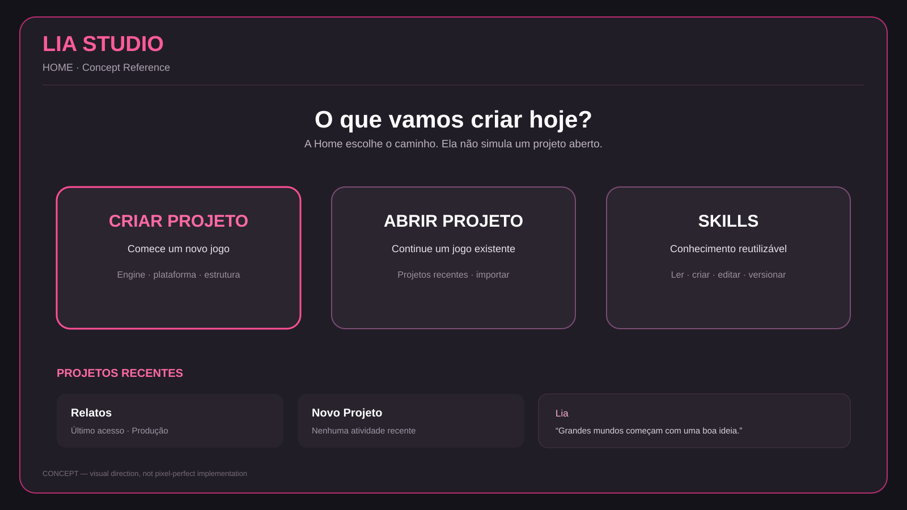

<h1 align="center">Lia Studio</h1>

<p align="center">
  <strong>Do primeiro conceito de jogo ao planejamento, revisão e entrega.</strong><br>
  Um espaço de criação para transformar ideias em projetos organizados, com assistência opcional de IA e decisões sempre supervisionadas.
</p>

<p align="center">
  <a href="#do-brief-ao-projeto">Conheça</a> ·
  <a href="#experimente-localmente">Começar</a> ·
  <a href="#estado-atual">Estado</a> ·
  <a href="docs/START-ROUTES-LIA-STUDIO.md">Guias de início</a>
</p>

> **Alpha local-first em desenvolvimento.** Os recursos de organização, planejamento, documentação e QA manual são reais. A execução geral de agentes, a geração de um jogo e builds por engines **não** estão integradas.

## Do brief ao projeto

O **Lia Studio** acompanha o desenvolvimento de jogos sem retirar as decisões criativas de quem está construindo. Comece com uma preparação guiada ou com um brief curto, detalhe o escopo, organize tarefas e registre as evidências de cada etapa.

<p align="center">
  <br>
  <sub>Concept versionado de direção e arquitetura da interface — não é uma captura da Alpha executada.</sub>
</p>

## O que você encontra no Studio

| Área | Para que serve |
| --- | --- |
| **Home e projetos** | Criar, abrir, renomear, arquivar e retomar projetos locais. |
| **Preparação e GDD** | Produzir briefs, escopo, decisões e documentos de referência revisáveis. |
| **Planejamento** | Organizar módulos, tarefas, critérios de aceite, dependências e etapas do jogo. |
| **Decisões** | Distinguir o que foi confirmado do que ainda é proposta, hipótese ou questão aberta. |
| **Skills** | Consultar, duplicar e editar conhecimentos reutilizáveis, inclusive importações locais do Agent Hub. |
| **QA e playtest** | Registrar verificações, critérios, evidências e decisões de aprovação manual. |
| **Animações** | Criar poses e gestos em um editor 2D com keyframes e biblioteca local; importar/exportar seu backup interno. |
| **IA opcional** | Consultar modelos anunciados pelo Ollama e produzir rascunhos controlados, com revisão de diff antes de aplicar alterações. |

### Um fluxo com decisões humanas

```text
Ideia → Preparação → MVP jogável → Produção → Finalização
          ↓                ↓
      Decisões         QA e evidências
```

As etapas são organizacionais: um checklist aprovado não cria automaticamente um jogo. O Studio diferencia **planejamento**, **simulação**, **execução comprovada** e **revisão humana**. Sem evidência real, os gates de conclusão permanecem bloqueados.

## Experimente localmente

A versão de desenvolvimento principal usa **Python 3.9+** e a biblioteca padrão:

```bash
python run.py
```

Abra o endereço local informado no terminal (por padrão, `http://127.0.0.1:8080`). A interface web funciona sem agente, sem modelo instalado e sem conexão obrigatória com outro produto Lia.

Há também um shell Windows opcional com WebView2, mas ele ainda depende de validação de distribuição. Para os testes da Alpha:

```bash
python verify_alpha.py --list-parts
python verify_alpha.py --part 1
```

Siga o [roteiro de uso e validação](docs/ALPHA-ROTEIRO-DE-TESTE.md) antes de testar a Alpha com dados importantes.

## Animações e interoperabilidade

O editor de animações do Studio trabalha com um **formato interno de rascunho**. A integração textual com especificações de animação do [Lia Forge](https://github.com/BloomRX/Lia-Forge) está sendo desenvolvida separadamente na [PR #2](https://github.com/BloomRX/Lia-Studio/pull/2); não é uma conversão automática de animação 2D para rig 3D ou VRM.

Veja o [escopo do editor de animações](docs/ANIMATION-AUTHORING-V1.md).

## Estado atual

O Studio é uma **Alpha funcional para preparação e organização**. A execução de Tasks por agentes é simulada ou restrita a capacidades muito específicas, como validação sintática de arquivo Python. Integrações completas com Godot/Unity/Unreal, automação de build/publicação e um runtime de agentes continuam por fazer. A consulta ao Ollama pode envolver modelos remotos conforme a configuração; nada é enviado automaticamente.

A experiência Windows e os fluxos de edição possuem testes documentados, mas não representam certificação para uso em produção.

## Explorar a documentação

- [Duas rotas de início](docs/START-ROUTES-LIA-STUDIO.md)
- [Visão da interface e conceitos](docs/concepts/README.md)
- [Arquitetura e decisões](docs/arquitetura-decisoes.md)
- [Escopo de Skills e agentes](docs/AI-AGENTS-UX.md)
- [Resultados e limites de testes](docs/testes-resultados.md)

## Ecossistema, colaboração e licença

O Studio se conecta conceitualmente à [Lia Desktop](https://github.com/BloomRX/Lia-Project), à fábrica de assets [Lia Forge](https://github.com/BloomRX/Lia-Forge) e à biblioteca de capacidades [Lia Agent Hub](https://github.com/BloomRX/Lia-AgentHub), sem exigir que esses aplicativos estejam instalados.

Para agentes de desenvolvimento e contribuidores: [`AGENTS.md`](AGENTS.md) e [`CLAUDE.md`](CLAUDE.md) contêm as regras de trabalho. Este README apresenta o produto e os caminhos para experimentá-lo.

Código próprio sob [MIT](LICENSE); personagem, nome, ícones e outros elementos de identidade seguem política de marca separada. Consulte os [avisos de terceiros](THIRD_PARTY_NOTICES.md).
